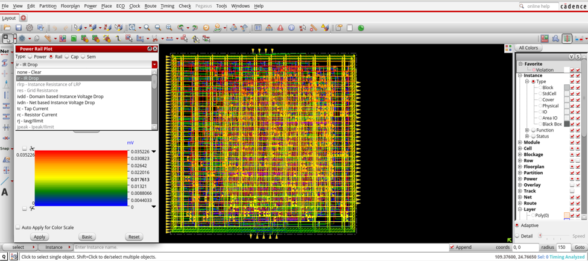

# Rail analysis (Cadence Voltus)

Static power-rail (IR drop) analysis of the final post-route database, 25 °C,
average-current mode, `VDD` = 0.9 V. Generated Oct 2026 with Voltus (Innovus 20.10 flow).



## Results

| Net | Nominal | Worst node | Max IR drop / ground bounce | Limit | Violations |
| :--- | :---: | :---: | :---: | :---: | :---: |
| `VDD` | 0.900 V | 0.899965 V | **35.2 µV** | 45 mV (5 %, threshold 0.855 V) | 0 |
| `VSS` | 0 V | 33.5 µV | **33.5 µV** | 45 mV | 0 |

- Total static current loaded: **84.4 µA** (consistent with ≈ 0.076 mW at 0.9 V in `../power/`).
- 1028 current taps, 10 325 power-grid resistor elements, 0 power-gate violations.
- The IR-drop plot (colour scale 0 → 0.035 mV) is `img/ir_drop.png`.

## Layout

```text
rail_analysis/
├── design_summary.rpt        run overview
└── static_25c/
    ├── vdd/  vss/
    │   ├── summary.rpt              net summary (voltage, IR drop, current)
    │   ├── ir_drop_by_layer.rpt     IR drop per metal layer
    │   ├── vsrc_current.rpt         voltage-source (pad) current
    │   ├── pg_integrity.rpt         missing views / disconnected instances
    │   ├── power_gate.rpt           power-gate check (no power gates in this design)
    │   ├── results.json             machine-readable results
    │   ├── ir_drop_map.gif          IR drop map
    │   └── ir_drop_limit_map.gif    IR drop vs. limit map
```

## Scope and caveats

- **Static only.** A dynamic (transient) run was also executed but it was not driven with
  real dynamic current (`Peak Dynamic Current: 0 A`), so it is not published.
- **Electromigration is not signed off here.** The EM section of `summary.rpt` was produced
  with a locally generated, non-foundry EM rule deck, and no J/Jmax values were reported.
  Do not read "0 violations" in that section as an EM signoff.
- Two identical static runs existed; only one is kept.
